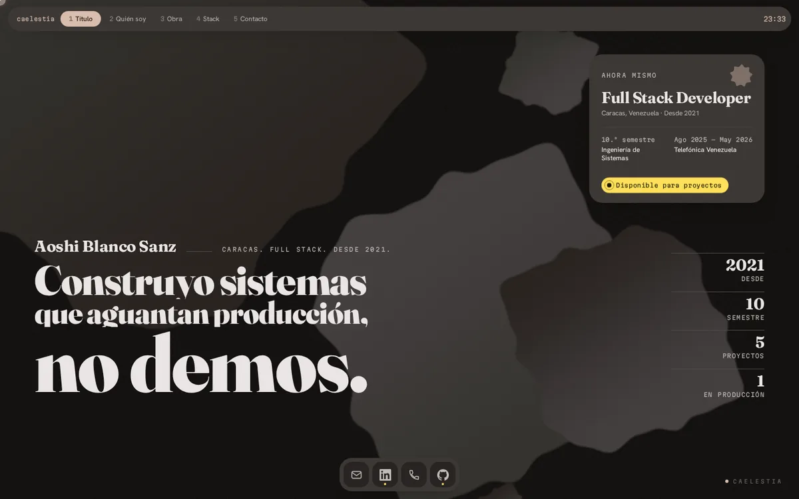
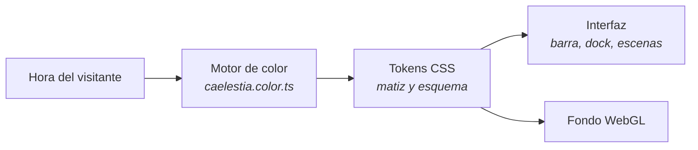
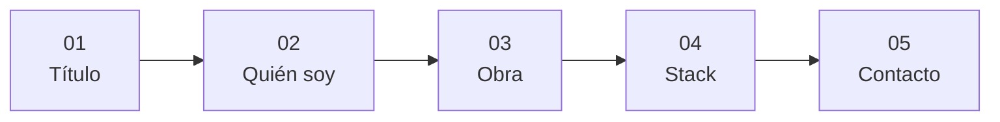

<div align="center">

# Portfolio — Aoshi Blanco Sanz

**Un escritorio en el navegador cuyo color decide la hora a la que entras.**

Desarrollador full stack · Caracas, Venezuela

</div>

---

## Sobre el proyecto

Este es mi portfolio, y también donde practico lo que me interesa: WebGL, animación y
accesibilidad.

La página es un escritorio inspirado en Material You: una barra superior con reloj, un dock y
cinco espacios de trabajo, uno por escena. El color no está fijo, lo calcula la hora del
visitante. De día es claro y de noche oscuro, y el matiz va girando a lo largo del día.



<sub>La captura es de las 23:33.</sub>

## Qué tiene

- **Color gobernado por el reloj.** Un motor de color calcula el matiz y el esquema claro u
  oscuro a partir de la hora local, y de ahí salen los tokens de toda la interfaz.
- **Fondo generativo en WebGL**: un shader de fragmento escrito a mano, sin motor 3D.
- **Cinco espacios de trabajo** en lugar de una página larga: se cambia de escena desde la barra,
  como en un gestor de ventanas.
- **Un cursor propio** que se apaga sobre texto corrido y deja el del sistema.
- **Animación con GSAP**, cargada en diferido para que no pese en el primer pintado.
- **Accesibilidad**: el contraste se mide contra el fondo real, el foco de teclado es visible en
  todo lo pulsable y cada animación tiene su alternativa para `prefers-reduced-motion`. Con
  movimiento reducido, el cambio de escena es instantáneo.
- **Todo el contenido en un solo sitio**, `src/data/content.ts`.



## Las cinco escenas



## Construido con

**Vite 8** · **TypeScript** en modo `strict` · **Tailwind 4** · **GSAP 3** · **WebGL**

Sin framework y sin backend: TypeScript modular sobre el DOM.

## Cómo verlo

> **Sin deploy todavía.** El sitio no está publicado en ninguna URL, así que por ahora la
> única forma de verlo es clonarlo.

```bash
git clone https://github.com/Aoshi346/portfolio-aoshi.git
cd portfolio-aoshi
nvm use          # Node 22, está en .nvmrc
npm install
npm run dev      # http://localhost:5173
```

| comando | qué hace |
|---|---|
| `npm run dev` | servidor de desarrollo |
| `npm run build` | `tsc && vite build` |
| `npm run preview` | sirve el build de producción |
| `npm run lint` | ESLint |

<sub>Hasta octubre de 2026 el sitio tenía tres temas (Vice, Hyprland y Caelestia) que se
sorteaban en cada visita. Siguen enteros en el tag
[`tres-temas`](https://github.com/Aoshi346/portfolio-aoshi/tree/tres-temas).</sub>

## Contacto

**a.blanco1501@gmail.com**

[GitHub](https://github.com/Aoshi346) · [LinkedIn](https://www.linkedin.com/in/aoshi-blanco-sanz-14119b2b7)

## Licencia

Sin licencia pública. Todos los derechos reservados: el contenido, los textos y las imágenes
son personales.
